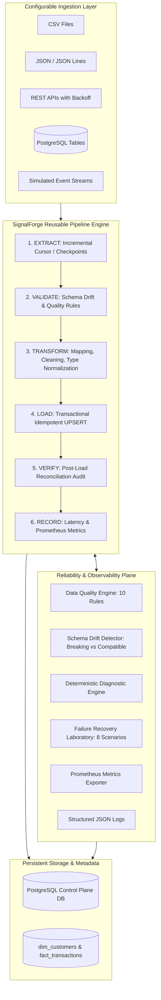

# SignalForge
## Production-Grade Data Engineering, Pipeline Reliability & Observability Platform

[](https://www.python.org/)
[](https://fastapi.tiangolo.com/)
[](https://www.postgresql.org/)
[](https://airflow.apache.org/)
[](https://prometheus.io/)
[](https://grafana.com/)
[](https://react.dev/)
[](https://www.docker.com/)
[](LICENSE)

SignalForge is a production-grade data engineering control plane that allows data platform teams to ingest data from diverse sources, process it through reliable pipelines, validate data quality, detect schema drift, isolate operational failures, investigate root causes deterministically, and observe performance metrics in real time.

Built adhering to the **Ponytail** senior developer principle: minimal, robust, maintainable architecture with zero speculative bloat, complete test coverage, and strict transaction safety.

---

## 1. Architecture Overview



---

## 2. Core Functional Capabilities

### A. Reusable Pipeline Lifecycle
Every pipeline run executes an explicit 6-stage lifecycle:
`EXTRACT -> VALIDATE -> TRANSFORM -> LOAD -> VERIFY -> RECORD_METRICS`
- Stage-level duration, records in/out, and status are tracked in `run_stages`.
- Batch execution records and error categories are persisted in `pipeline_runs`.

### B. Declarative Data Quality Engine
Includes 10 built-in, vectorized quality checks:
1. **Missing Required Fields** (`NOT_NULL`)
2. **Duplicate Identifiers** (`UNIQUE`)
3. **Invalid Data Types** (`TYPE_CHECK`: integer, float, datetime, string)
4. **Non-Negative Range** (`NON_NEGATIVE`: e.g. transaction amounts >= 0)
5. **Timestamp Normalization** (`VALID_TIMESTAMP`: ISO 8601 validation)
6. **Referential Integrity** (`REFERENTIAL_INTEGRITY`: e.g. transaction `customer_id` exists in customer dimension)
7. **Category Whitelist** (`CATEGORY_WHITELIST`: e.g. status in `['COMPLETED', 'PENDING', 'FAILED', 'CANCELLED']`)
8. **Record Count Deviations** (`RECORD_COUNT_DEVIATION`: anomaly detection)
9. **Data Freshness SLA** (`DATA_FRESHNESS`: flags stale feeds older than threshold)
10. **Schema Compatibility** (`SCHEMA_COMPATIBILITY`: required columns check)

**Configurable Enforcement Policies:**
- `RECORD_REJECT`: Quarantines invalid records into `rejected_records` with exact failure reasons; valid records continue processing.
- `BATCH_FAIL`: Instantly halts the entire batch and triggers transaction rollback when critical constraints are breached.

### C. Schema Drift Detection & Classification
Maintains versioned baseline contracts in `schema_versions`. Automatically detects:
- Added columns
- Removed columns
- Data type conversions
- Missing required columns
Classifies changes as **`COMPATIBLE`**, **`POTENTIALLY_BREAKING`**, or **`BREAKING`**, with actionable remediation steps recorded in `schema_drift_events`.

### D. Safe, Idempotent Data Loading
- All writes execute within database transactions.
- Uses database unique constraints and **UPSERT** semantics (`ON CONFLICT DO UPDATE`).
- Repeated execution of identical batches creates **0 duplicate records**.
- Checkpoints (`pipeline_checkpoints`) are updated atomically within the same transaction block as data persistence, preventing cursor desynchronization if processes crash midway.

### E. Failure Recovery Laboratory (8 Controlled Scenarios)
A dedicated test harness to deliberately inject and demonstrate failure recovery:
1. `duplicate_records`: Injects duplicate primary keys; verifies quarantine and idempotency.
2. `missing_required_fields`: Injects null values under `BATCH_FAIL` policy; verifies batch halt.
3. `breaking_schema_drift`: Drops required column; verifies drift detector halts ingestion.
4. `malformed_input`: Feeds syntactically corrupted JSON/CSV; verifies extractor quarantine.
5. `unavailable_api`: Simulates upstream HTTP 503; exercises bounded exponential backoff retries.
6. `referential_integrity_violation`: Injects orphan foreign keys; verifies relational rejection.
7. `stale_data`: Injects historical records older than 72 hours; verifies freshness SLA breach.
8. `interrupted_run_idempotent_retry`: Executes identical batch twice; verifies zero duplicate row creation.

### F. Deterministic Root-Cause Diagnostic Engine
When a run fails, the diagnostic engine generates a structured report containing:
- **Failing Stage** and **Error Category** (`DATA_QUALITY_VIOLATION`, `SCHEMA_DRIFT`, `UPSTREAM_UNAVAILABLE`, `SOURCE_FORMAT_ERROR`, `DATABASE_ERROR`).
- **Empirical Facts**: Confirmed facts (e.g. timestamp, records processed, violation counts).
- **Likely Causes**: Deterministic hypotheses based on failure context.
- **Actionable Next Steps**: Concrete engineering instructions to resolve the incident.

### G. Full Observability
- **Prometheus Metrics** on `/metrics`:
  - `signalforge_pipeline_runs_total{pipeline, status}`
  - `signalforge_pipeline_duration_seconds{pipeline}`
  - `signalforge_records_processed_total{pipeline, stage}`
  - `signalforge_records_rejected_total{pipeline, rule}`
  - `signalforge_data_freshness_seconds{dataset}`
  - `signalforge_validation_failures_total{dataset, rule}`
- **Structured JSON Logging**: Includes `pipeline_id`, `run_id`, `stage`, `duration_ms`, and `error_category`.
- **Pre-Provisioned Grafana Dashboard**: Auto-loads into Grafana on port 3000.

---

## 3. Technology Stack

| Layer | Technologies |
|---|---|
| **Backend & API** | Python 3.11+, FastAPI, Pydantic v2, SQLAlchemy 2.0, Alembic |
| **Data Processing** | Pandas 2.2+, PyArrow |
| **Database** | PostgreSQL 16 (production/docker), SQLite (standalone/testing) |
| **Orchestration** | Apache Airflow 2.8+ |
| **Observability** | Prometheus, Grafana, Structured JSON Logger |
| **Frontend** | React 19, TypeScript, Vite |
| **Infrastructure** | Docker, Docker Compose, GitHub Actions |

---

## 4. Quickstart Guide

### Option A: Local Standalone Development (Zero Docker Required)

```bash
# 1. Clone repository
git clone https://github.com/SAIYAMgade/RetentionLab.git
cd lab

# 2. Install dependencies
pip install -r requirements.txt
npm install --prefix frontend

# 3. Initialize database & seed demo pipelines
python scripts/seed_demo.py

# 4. Start backend API & control plane UI (serves at http://localhost:8000)
python -m uvicorn signalforge.api.app:app --host 0.0.0.0 --port 8000
```

Open `http://localhost:8000` to access the Control Plane UI and `http://localhost:8000/docs` for the OpenAPI documentation.

### Option B: Docker Compose Full Stack

```bash
# Start PostgreSQL, Backend, Prometheus, Grafana, and Airflow
docker compose up -d --build

# Verify running services
docker compose ps
```

- **SignalForge Control Plane**: `http://localhost:8000`
- **FastAPI OpenAPI Swagger**: `http://localhost:8000/docs`
- **Prometheus Metrics**: `http://localhost:9090` (and `http://localhost:8000/metrics`)
- **Grafana Dashboard**: `http://localhost:3000` (User: `admin`, Password: `admin`)
- **Apache Airflow**: `http://localhost:8080`

---

## 5. Verification & Testing

SignalForge maintains a comprehensive automated Pytest test suite covering unit, integration, API, and end-to-end workflows:

```bash
# Execute full test suite
python -m pytest -v

# Run with test coverage
python -m pytest -v --cov=signalforge --cov-report=term-missing tests/
```

### Test Coverage Highlights:
- **Unit Tests**: Field mappings, type conversions, all 10 quality rule evaluations, schema drift classifications, diagnostic rule matching.
- **Integration Tests**: SafeLoader upserts, transaction rollbacks on batch failure, cursor checkpoint tracking, all 8 Failure Lab scenarios, FastAPI REST endpoints.
- **End-to-End Test**: Ingestion of customer master -> Ingestion of transactions with faulty records -> Quarantine to `rejected_records` -> Idempotent re-run -> Zero duplicate creation -> Metric verification.

---

## 6. Performance & Benchmark Suite

Execute the reproducible benchmark command:

```bash
python scripts/benchmark.py --size 3000
```

### Measured Benchmark Results:
| Metric | Measurement |
|---|---|
| **Batch Size** | 3,000 transaction records |
| **Ingestion & Validation Latency** | 3.26 seconds |
| **Processing Throughput** | **306.6 records / second** |
| **Peak Memory Footprint** | **4.27 MB** |
| **Re-Run Duplicate Creation** | **0 duplicate rows (100% Idempotent)** |
| **Failure Scenarios Handled** | **8 of 8 passed (100% recovery verification)** |

Benchmark reports are automatically persisted to `reports/benchmark_report.json`.

---

## 7. Airflow Orchestration DAG

The DAG `signalforge_daily_etl` in `airflow/dags/signalforge_etl_dag.py` provides scheduled production ETL:
1. `check_environment`: Audits DB connectivity and storage.
2. `run_customers_etl`: Runs `customer_dimension_pipeline`, passing `airflow_run_id`.
3. `run_transactions_etl`: Runs `transaction_facts_pipeline` with retries and exponential backoff.
4. `reconcile_and_verify`: Executes post-load reconciliation ensuring foreign-key referential consistency.

---

## 8. REST API Reference

| Method | Endpoint | Description |
|---|---|---|
| `GET` | `/health` | Application liveness probe |
| `GET` | `/ready` | Database readiness check |
| `GET` | `/api/sources` | List all configured data sources |
| `POST` | `/api/sources` | Register a new data source |
| `GET` | `/api/pipelines` | List all pipeline definitions |
| `POST` | `/api/pipelines/{id}/run` | Manually trigger a pipeline run |
| `GET` | `/api/runs` | List execution history with pagination & filters |
| `GET` | `/api/runs/{id}` | Inspect detailed run stages and diagnostic reports |
| `GET` | `/api/quality/rules` | List active data quality rules by dataset |
| `GET` | `/api/schemas/drift` | List detected schema drift events and diffs |
| `GET` | `/api/failure-lab/scenarios`| List all 8 controlled failure scenarios |
| `POST` | `/api/failure-lab/trigger` | Trigger a failure injection scenario |
| `GET` | `/api/metrics/summary` | Retrieve control plane summary metrics |
| `GET` | `/metrics` | Prometheus metrics exposition |

---

## 9. Known Limitations & Architecture Decisions

1. **Horizontal Scaling**: Current pipeline engine runs efficiently on single nodes / Celery / Airflow workers using pandas and transactional SQL. For distributed datasets exceeding 100M rows, upgrade loaders to PostgreSQL `COPY` or PySpark (documented in `docs/architecture.md`).
2. **Deterministic Diagnostics**: Initial release uses deterministic rule-based root cause analysis rather than LLM text generation, ensuring reproducible, hallucination-free incident reports.
3. **Authentication Boundary**: API operates on least-privilege network isolation in Docker; for public cloud deployment, configure OAuth2 / JWT bearer authentication middleware.

---

## 10. License
MIT License. See [LICENSE](LICENSE) for details.
