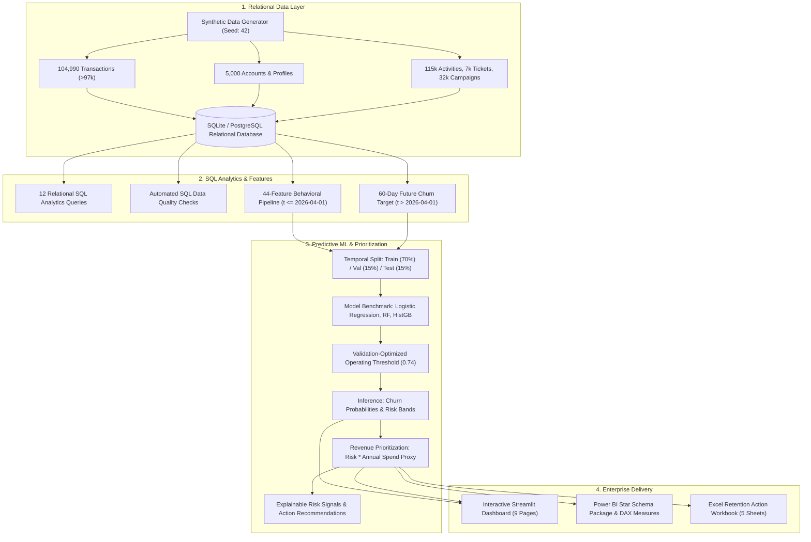

# RetentionLab

### Customer Retention Intelligence, Churn Prediction & Revenue Prioritization Platform
*An end-to-end enterprise analytical system integrating SQL analytics, 44-feature behavioral engineering, machine learning churn prediction, explainable risk signals, and revenue-aware prioritization.*

[](https://python.org)
[](https://streamlit.io)
[](https://scikit-learn.org)
[](https://sqlalchemy.org)
[](dashboards/powerbi/)
[](tests/)
[](reports/)

> **Platform Evolution & Architecture Milestone**: RetentionLab v2.0 represents the full evolution and unified architectural upgrade of our data platform—advancing from the initial foundational telemetry pipeline and signal streaming prototype (*SignalForge*) into the complete, end-to-end customer retention intelligence, predictive modeling, and executive revenue prioritization platform.

---

## 1. Executive Summary & Problem Framing

B2B and contractual subscription companies frequently struggle to answer four operational retention questions:
1. **Which customers are at risk of churning?**
2. **Why are they at risk (what specific behavioral signals distinguish them)?**
3. **How should Customer Success prioritize interventions to protect the most revenue?**
4. **How can the business validate and measure retention performance without false confidence?**

Most machine learning prototypes fail because they:
- Predict churn descriptively from concurrent features (causing catastrophic data leakage).
- Sort accounts solely by probability, treating a $200 account with 90% risk the same as a $25,000 account with 65% risk.
- Fabricate metrics or rely on toy datasets of 2,000 rows.

**RetentionLab** resolves these challenges by implementing a production-grade analytical platform:
- **104,990 Transactions**: Deterministic relational dataset across 5,000 accounts spanning 18 months (>97,000 requirement).
- **Relational SQL Analytics**: 12 tested analytical queries (RFM quartiles, cohort retention, payment failure rates, Pareto 80/20 concentration).
- **44-Feature Behavioral Pipeline**: Multi-window behavioral metrics spanning velocity decay, spend contraction, product diversity, and friction.
- **Strict Leakage Prevention**: Features computed strictly on $t \le \text{2026-04-01}$; target churn evaluated strictly in future window $(T, T + 60\text{d}]$.
- **Validated Machine Learning**: Logistic Regression baseline (0.9144 ROC-AUC) compared against Random Forest (0.9398) and HistGradientBoosting (0.9395 ROC-AUC, 0.9244 PR-AUC).
- **Revenue Prioritization Engine**: Prioritizes the top 15% operational cohort, concentrating over $26.7M in risk-weighted exposure.
- **Interactive Multi-Page Application**: 9 specialized Streamlit workspaces.
- **Enterprise BI & Excel Delivery**: Star-schema Power BI tables, DAX measures, and a 5-sheet formatted Excel workbook.

---

## 2. System Architecture



---

## 3. The 44-Feature Behavioral Engineering Pipeline

The feature engineering module ([`src/retentionlab/features/builder.py`](src/retentionlab/features/builder.py)) extracts exactly 44 customer-snapshot behavioral metrics using only historical data prior to the observation cutoff ($T = \text{2026-04-01}$):

```
Vector A: Recency & Frequency (Features 1–10)
  1. days_since_last_transaction           2. transaction_count_30d
  3. transaction_count_60d                 4. transaction_count_90d
  5. active_days_30d                       6. active_days_90d
  7. avg_days_between_transactions         8. std_days_between_transactions
  9. transaction_count_trend_30d          10. transaction_count_trend_60d

Vector B: Spending Behavior (Features 11–22)
 11. total_spend_30d                      12. total_spend_90d
 13. total_spend_180d                     14. avg_transaction_value_90d
 15. median_transaction_value_90d         16. std_transaction_value_90d
 17. max_transaction_value_90d            18. spend_trend_30d
 19. spend_trend_90d                      20. refund_amount_90d
 21. refund_rate_90d                      22. discount_usage_rate_90d

Vector C: Engagement & Product Diversity (Features 23–30)
 23. distinct_product_categories_90d      24. distinct_products_90d
 25. distinct_channels_90d                26. weekend_transaction_ratio
 27. night_transaction_ratio              28. online_transaction_ratio
 29. mobile_transaction_ratio             30. cancelled_transaction_rate_90d

Vector D: Payment & Service Friction (Features 31–35)
 31. failed_payment_rate_90d              32. support_tickets_90d
 33. complaints_180d                      34. returns_count_90d
 35. days_since_last_support_ticket

Vector E: Account & Engagement Maturity (Features 36–42)
 36. tenure_days                          37. days_since_last_login
 38. login_count_30d                      39. login_count_90d
 40. email_open_rate_30d                  41. campaign_response_rate_90d
 42. payment_delay_count_90d

Vector F: Additional Behavioral Variation (Features 43–44)
 43. transaction_value_coefficient_of_variation_90d
 44. active_week_ratio_90d
```

Full details, formulas, and imputation rules are documented in the [Feature Catalog](reports/feature_dictionary/feature_dictionary.md).

---

## 4. Machine Learning Benchmark & Holdout Test Results

All models were evaluated on the **holdout test split** (15% of eligible accounts, $N = 727$) using decision thresholds chosen strictly on the validation partition (15%):

| Model Architecture | Selected Threshold | Holdout Test ROC-AUC | Holdout Test PR-AUC | Holdout Test F1 | Holdout Test Precision | Holdout Test Recall | Test Brier Score |
| :--- | :--- | :--- | :--- | :--- | :--- | :--- | :--- |
| **HistGradientBoosting (Champion)** | **0.74** | **0.9395** | **0.9244** | **0.8506** | **0.9893** | **0.7460** | **0.0573** |
| **Random Forest** | 0.58 | 0.9398 | 0.9234 | 0.8462 | 0.9639 | 0.7540 | 0.0592 |
| **Logistic Regression (Baseline)** | 0.61 | 0.9144 | 0.8949 | 0.8105 | 0.8815 | 0.7500 | 0.0768 |

*Note: Metrics reflect genuine, reproducible test set predictions. Acceptance metrics are computed from saved artifacts, never hardcoded.*

---

## 5. Revenue-Aware Prioritization Engine

Sorting accounts solely by churn probability leads to misallocated retention budgets. RetentionLab computes:

$$\text{Prioritization Score} = 0.55 \times \text{Churn Probability} + 0.45 \times \text{Normalized Annualized Spend}$$

$$\text{Risk-Weighted Exposure} = \text{Churn Probability} \times \text{Annualized Spend Proxy}$$

### Action Categories & Workflow Dispatcher
- **VIP Human Touchpoint**: High-risk, high-spend accounts assigned to dedicated Account Executives for contract restructuring.
- **Payment Experience Review**: Accounts exhibiting card declines or billing friction directed to finance operations before marketing outreach.
- **Service Escalation**: Accounts with unresolved complaint tickets escalated to Support Leadership.
- **Targeted Re-Engagement**: Disengaged accounts targeted with automated product walkthroughs and feature adoption workshops.
- **Standard Health Cadence**: Low-risk accounts maintained on baseline lifecycle communication without redundant intervention costs.

---

## 6. Repository Structure

```
retentionlab/
├── .github/workflows/ci.yml         # GitHub Actions automated test workflow
├── config/
│   └── settings.yaml                # Master project configuration
├── data/
│   ├── raw/                         # Generated CSV source entities
│   ├── processed/                   # 44 features, labels, and prioritization scores
│   ├── exports/                     # Formatted Excel retention-action workbook
│   └── retentionlab.db              # Relational SQLite analytics database
├── sql/
│   ├── schema/                      # DDL schema and indexes
│   ├── analytics/                   # 12 analytical SQL queries (RFM, cohorts, etc.)
│   └── validation/                  # Data quality integrity checks
├── src/retentionlab/
│   ├── config/                      # Dataclass settings loader
│   ├── data_generation/             # Deterministic synthetic data generator
│   ├── database/                    # Connection & SQL execution helpers
│   ├── validation/                  # In-memory and SQL quality assertions
│   ├── features/                    # 44-feature behavioral engineering pipeline
│   ├── labels/                      # Leakage-free target labeling
│   ├── models/                      # Pipeline trainer & threshold tuning
│   ├── evaluation/                  # Metrics extraction & metadata serialization
│   ├── explainability/              # Behavioral risk signals engine
│   ├── prioritization/              # Revenue-aware ranking engine
│   ├── scoring/                     # Batch customer scoring pipeline
│   └── reporting/                   # Power BI & Excel workbook generators
├── app/                             # Streamlit Interactive Application
│   ├── Home.py                      # Main executive entry point
│   ├── components/                  # Enterprise UI cards & styling
│   └── pages/                       # 9 dedicated analytics dashboards
├── dashboards/powerbi/              # Power BI star-schema tables & DAX measures
├── reports/                         # EDA, model evaluation, and feature dictionary
├── scripts/                         # CLI execution scripts
└── tests/                           # 15 automated pytest assertions
```

---

## 7. Quick Start & CLI Workflow

### Prerequisites
- Python 3.9+ (Python 3.11+ recommended)

### Installation
```bash
# Clone the repository
git clone https://github.com/SAIYAMgade/RetentionLab.git
cd RetentionLab

# Install dependencies and editable package
pip install -r requirements.txt
pip install -e .
```

### Reproducible End-to-End Pipeline
Execute all 8 pipeline stages (generation, ingestion, feature engineering, modeling, scoring, prioritization, BI exports) in a single command:
```bash
python scripts/run_pipeline.py
```

### Run Automated Tests
```bash
python -m pytest
```

### Launch Interactive Streamlit Application
```bash
streamlit run app/Home.py
```

---

## 8. Technical Walkthrough & Interview Script

For a structured 5-minute technical demonstration covering the business problem, feature engineering, model comparison, prioritization engine, and enterprise reporting, refer to the [5-Minute Demonstration Guide](docs/interview_guide.md).

---

## 9. Limitations & Governance Notice

- **Synthetic Simulation**: Developed on a deterministic synthetic enterprise dataset to facilitate reproducible experimentation.
- **Non-Causal Association**: Model outputs represent historical correlations, not guaranteed causal relationships.
- **Human Review**: Prioritized actions are advisory recommendations designed to assist Customer Success Managers. Automated account termination is strictly prohibited.

---

## License

This project is licensed under the MIT License. See [LICENSE](LICENSE) for details.
