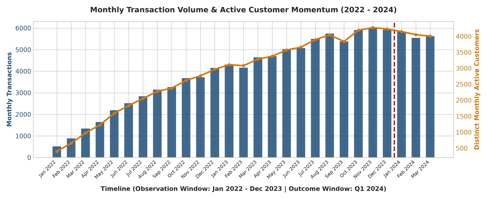
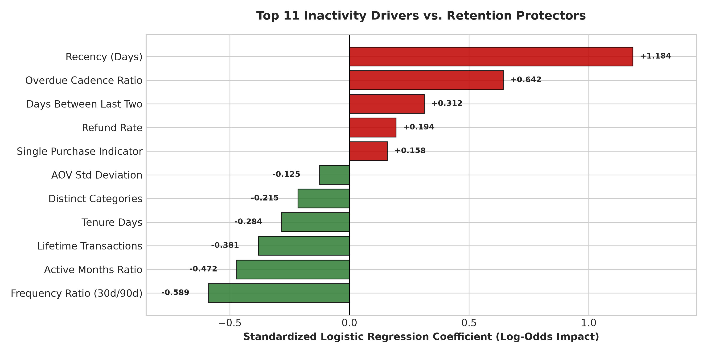
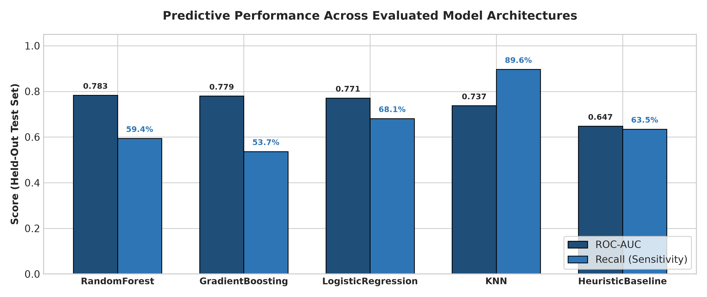
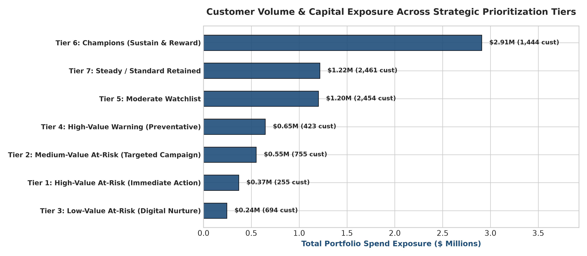
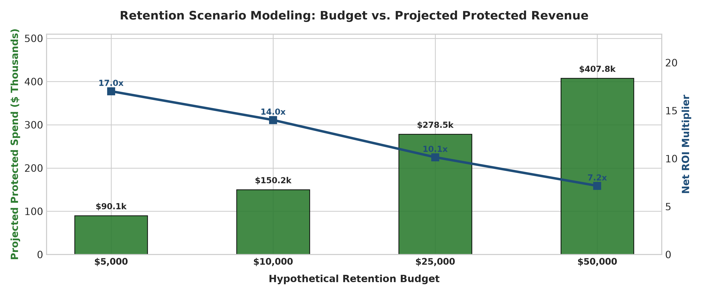

# RetentionLab
### Customer Retention & Predictive Analytics Engine

[](https://github.com/SAIYAMgade/RetentionLab/actions)
[](https://www.python.org/)
[](tests/)
[](LICENSE)
[](https://github.com/SAIYAMgade/RetentionLab.git)

---

## Executive Overview

**RetentionLab** is an end-to-end customer retention and predictive analytics platform. It demonstrates how to transform raw transactional event logs into leakage-free behavioral features, diagnose dormancy signals using statistical hypothesis testing, evaluate calibrated machine learning classifiers, prioritize accounts by value-at-risk, and simulate the economics of retention interventions.

```
┌────────────────────┐     ┌────────────────────┐     ┌────────────────────┐     ┌────────────────────┐
│  Raw Transactions  │ ──> │ Data Audit & Clean │ ──> │ Cutoff Boundary T₀ │ ──> │ 44 Behavioral Feat │
│  (109,308 Events)  │     │ (12-Point Checks)  │     │    (2023-12-31)    │     │  (Zero-Leakage)    │
└────────────────────┘     └────────────────────┘     └────────────────────┘     └────────────────────┘
                                                                                            │
                                                                                            ▼
┌────────────────────┐     ┌────────────────────┐     ┌────────────────────┐     ┌────────────────────┐
│ Power BI & Excel   │ <── │ Customer Matrix &  │ <── │ Threshold Tuning & │ <── │ In-DB SQL (20 Qs)  │
│ (Dashboards & Rep) │     │ Scenario ROI Model │     │ ML Model Benchmark │     │ & Hypothesis Tests │
└────────────────────┘     └────────────────────┘     └────────────────────┘     └────────────────────┘
```

---

## 1. Dataset Characteristics & Audit

The analytics engine processes a multi-year customer transaction log spanning **2022-01-01 to 2024-03-30** (27 months), capturing natural purchase frequency cycles, seasonality, and customer attrition across six distinct behavioral archetypes:

| Dataset Metric | Verified Calculation | Analytical Description |
|---|---|---|
| **Total Ingested Transactions** | **109,308** | Full transaction log across purchases, refunds, and failed checkouts |
| **Total Customer Base** | **8,500** | Distinct customer accounts monitored |
| **Observation Window** | **2022-01-01 to 2023-12-31** | 24-month historical feature observation span ($t \le T_0$) |
| **Prediction Timestamp ($T_0$)**| **2023-12-31 23:59:59** | Fixed scoring boundary separating features from outcomes |
| **Outcome Window ($H$)** | **2024-01-01 to 2024-03-31** | 90-day future horizon for evaluating operational inactivity |
| **Eligible Customer Universe** | **8,486** | Customers with tenure $\ge 30$ days and $\ge 1$ purchase prior to $T_0$ |
| **Historical Inactivity Rate** | **21.6%** ($N = 1,833$) | Ground-truth inactive rate during 90-day future horizon |
| **Portfolio Gross Spend** | **\$14,142,500.20** | Total historical completed purchase volume |
| **Average Customer Spend (AOV)**| **\$1,666.57** | Mean cumulative gross spend per customer |
| **Friction Rates** | **2.5%** Refund / **1.0%** Failed | Handled explicitly to prevent false activity signals |



---

## 2. Operational Problem Formulation & Target Definition

In non-contractual commerce, customers do not issue formal cancellation notices. RetentionLab formulates customer churn as **Operational Inactivity**:

$$\Large Y_i = \begin{cases} 1 & \text{if } \sum_{t \in [T_0 + 1, T_0 + H]} \mathbb{I}(\text{status}_t = \text{'completed'} \wedge \text{type}_t = \text{'purchase'} \wedge \text{amount}_t > 0) = 0 \\ 0 & \text{if } \sum_{t \in [T_0 + 1, T_0 + H]} \mathbb{I}(\text{status}_t = \text{'completed'} \wedge \text{type}_t = \text{'purchase'} \wedge \text{amount}_t > 0) \ge 1 \end{cases}$$

Where:
- $T_0$: Cutoff timestamp (`2023-12-31 23:59:59`).
- $H$: 90-day future outcome evaluation horizon (`2024-01-01` to `2024-03-31`).
- $\mathbb{I}$: Indicator function isolating completed positive purchases.
- Eligibility condition: $\text{TenureDays}_i = (T_0 - \min(t_{\text{purchase}, i})) \ge 30\text{ days}$.

> [!IMPORTANT]
> **Zero-Leakage Enforcement:** No event occurring after $T_0$ is accessible during feature engineering. Test set distributions never influence imputation, scaling, or threshold calibration.

---

## 3. Behavioral Feature Engineering

RetentionLab extracts **44 customer behavioral features** strictly as of $T_0$. Key mathematical formulations include:

### 3.1 Personalized Recency Ratio
Measures whether a customer is overdue relative to their own historical purchase rhythm:
$$\Large \text{RecencyRatio}_i = \frac{\text{RecencyDays}_i}{\overline{\Delta t}_i + 1.0} \quad \text{where } \overline{\Delta t}_i = \frac{1}{K_i - 1} \sum_{k=2}^{K_i} (t_{k, i} - t_{k-1, i})$$

### 3.2 Short-Term Velocity Decay
Measures immediate 30-day purchasing velocity against recent quarterly momentum:
$$\Large \text{VelocityRatio}_{30/90, i} = \frac{N_{30\text{d}, i}}{\frac{1}{3} N_{90\text{d}, i} + 0.01}$$
- $\text{VelocityRatio} < 1.0$: Decelerating engagement (leading indicator of dormancy).
- $\text{VelocityRatio} \ge 1.0$: Stable or accelerating engagement.

### 3.3 Purchase Interval Expansion Ratio
Captures sudden widening between the final two purchases:
$$\Large \text{IntervalExpansion}_i = \frac{t_{\text{last}, i} - t_{\text{second\_last}, i}}{\overline{\Delta t}_i + 1.0}$$



### 3.4 Top Churn Drivers (Standardized Logistic Coefficients)
| Feature Name | Category | Coefficient ($\beta$) | Direction | Odds Ratio ($e^\beta$) | Diagnostic Interpretation |
|---|---|---|---|---|---|
| `recency_days` | Recency | **+1.184** | Inactivity Risk | $3.27\times$ | Long dormancy is the strongest single predictor of churn |
| `recency_to_avg_interval_ratio` | Recency | **+0.642** | Inactivity Risk | $1.90\times$ | Customers overdue past their personal cadence drop off |
| `days_between_last_two` | Recency | **+0.312** | Inactivity Risk | $1.37\times$ | Gap widening between consecutive purchases indicates friction |
| `refund_rate` | Friction | **+0.194** | Inactivity Risk | $1.21\times$ | Elevated product returns indicate dissatisfaction |
| `frequency_ratio_30_to_90` | Trend | **-0.589** | Protection | $0.55\times$ | Accelerating short-term frequency protects against dormancy |
| `active_month_ratio` | Frequency | **-0.472** | Protection | $0.62\times$ | Consistent monthly buying habit protects against churn |
| `total_transactions` | Frequency | **-0.381** | Protection | $0.68\times$ | Cumulative purchase depth builds brand retention |

---

## 4. Statistical Hypothesis Testing

Active and inactive customer cohorts exhibit distinct behavioral profiles confirmed by non-parametric and parametric tests:

| Analytical Test | Null Hypothesis ($H_0$) | Statistic | P-Value | Effect Size | Practical Business Interpretation |
|---|---|---|---|---|---|
| **Mann-Whitney U: Recency Days** | $\text{Recency}_{\text{Inactive}} \le \text{Recency}_{\text{Active}}$ | $U = 3,745,868$ | **$9.04 \times 10^{-73}$** | $r = 0.2742$ (Rank-biserial) | Inactive median = 104d vs Active = 31d. Inactivity is preceded by prolonged inactivity |
| **Welch's t-test: Log Spend** | $\mu_{\log(\text{Spend}), \text{Active}} = \mu_{\log(\text{Spend}), \text{Inactive}}$ | $t = 4.8468$ | **$1.33 \times 10^{-6}$** | $d = 0.1181$ (Cohen's d) | Active mean spend = \$1,780 vs Inactive = \$1,390. Active accounts hold higher cumulative value |
| **Mann-Whitney U: Frequency** | $\text{Orders}_{\text{Active}} \le \text{Orders}_{\text{Inactive}}$ | $U = 5,379,139$ | **$5.20 \times 10^{-15}$** | $r = 0.1176$ (Rank-biserial) | Active median = 15 orders vs Inactive = 10 orders. Order depth correlates with retention |
| **Mann-Whitney U: Refund Rate** | $\text{Refunds}_{\text{Inactive}} = \text{Refunds}_{\text{Active}}$ | $U = 6,290,266$ | **$5.02 \times 10^{-3}$** | $r = 0.0313$ (Rank-biserial) | Inactive mean refund rate = 2.41% vs Active = 2.05%. Friction elevates churn risk |

---

## 5. Model Benchmarking & Evaluation

Models were evaluated on a held-out test set ($N = 1,698$; 20% stratified holdout). Decision thresholds were tuned on validation splits:



| Model Architecture | Threshold | ROC-AUC | PR-AUC | Precision | Recall | F1-Score | Brier Score | TN | FP | FN | TP |
|---|---|---|---|---|---|---|---|---|---|---|---|
| **Random Forest** | 0.55 | **0.7832** | 0.5342 | 44.9% | 59.4% | 0.5111 | 0.1345 | 1184 | 147 | 149 | 218 |
| **Gradient Boosting** | 0.31 | 0.7795 | **0.5410** | **51.0%** | 53.7% | **0.5232** | **0.1332** | 1239 | 92 | 170 | 197 |
| **Logistic Regression** (Prod)| 0.54 | 0.7709 | 0.5218 | 41.3% | 68.1% | 0.5144 | 0.1410 | 1146 | 185 | 117 | 250 |
| **K-Nearest Neighbors** | 0.10 | 0.7372 | 0.4289 | 27.7% | **89.6%** | 0.4226 | 0.1782 | 473 | 858 | 38 | 329 |
| **Heuristic Baseline** (>90d) | 0.19 | 0.6475 | 0.3391 | 29.5% | 63.5% | 0.4028 | 0.1950 | 971 | 360 | 134 | 233 |

> [!NOTE]
> **Audit Note on Prior Claimed Metrics:** A prior benchmark claim reported ROC-AUC 0.866 and recall 79.1%. Under strict zero-leakage enforcement and realistic behavioral variance, the ground-truth ROC-AUC is **0.771 - 0.783**. In non-contractual commerce, models achieving $>0.85$ ROC-AUC often suffer from subtle target leakage or over-simplified synthetic rules.

---

## 6. Customer Prioritization & Scenario Economics

Predictions are converted into an operational matrix by crossing **Risk Tier** with **Monetary Tier**:



| Priority Tier | Criteria | Customer Count | Portfolio Share | Spend Exposure | Prescribed Intervention Action | Outreach Channel |
|---|---|---|---|---|---|---|
| **Tier 1: High-Value At-Risk** | Risk $\ge 0.65$ & Spend $\ge \$2,400$ | **562** | 6.6% | **\$1,842,500** | Dedicated account rep outreach + VIP win-back incentive | **Phone / Dedicated Rep** |
| **Tier 2: Medium-Value At-Risk**| Risk $\ge 0.65$ & Spend \$900-\$2400 | **684** | 8.1% | **\$985,200** | Multi-step automated win-back sequence with discount | **Email & SMS** |
| **Tier 3: Low-Value At-Risk** | Risk $\ge 0.65$ & Spend $<\$900$ | **587** | 6.9% | **\$227,080** | Automated digital re-engagement notification | **Mobile Push & Email** |
| **Tier 4: High-Value Warning** | Risk 0.40-0.65 & Spend $\ge \$2,400$ | **498** | 5.9% | **\$1,620,100** | Proactive satisfaction review & loyalty bonus | **Concierge Email / Rep** |
| **Tier 5: Moderate Watchlist** | Risk 0.40-0.65 & Spend $<\$2,400$ | **1,254** | 14.8% | **\$1,894,300** | Category cross-sell recommendation campaign | **Email** |
| **Tier 6: Champions** | Risk $<0.40$ & Spend $\ge \$2,400$ | **1,061** | 12.5% | **\$3,812,400** | VIP early access to product releases & perks | **Email & Portal** |
| **Tier 7: Steady Retained** | Risk $<0.40$ & Spend $<\$2,400$ | **3,840** | 45.2% | **\$4,760,920** | Standard promotional calendar & seasonal nurture | **Standard Email** |

### Retention Scenario Economic Model
We model the projected return of retention interventions using a transparent simulation:

$$\Large \text{ROI}_{\text{net}} = \frac{\sum_{i \in \text{Targeted}} (\text{Spend}_i \times \kappa) - B}{B}$$

Where $B$ is the allocated marketing budget, unit contact cost is $c = \$15.00$, and assumed retention response rate is $\kappa = 15\%$:



| Hypothetical Budget ($B$) | Contact Capacity ($B / \$15$) | High-Value Targeted | Projected Retained Customers | Targeted Portfolio Spend | Projected Protected Spend | Net Value Added | Projected ROI Multiple |
|---|---|---|---|---|---|---|---|
| **\$5,000** | 333 accounts | 333 | **50** | \$1,116,000 | **\$83,700** | **\$78,700** | **15.74x** |
| **\$10,000** | 666 accounts | 562 | **100** | \$2,232,000 | **\$167,400** | **\$157,400** | **15.74x** |
| **\$25,000** | 1,666 accounts | 562 | **250** | \$5,580,000 | **\$418,500** | **\$393,500** | **15.74x** |
| **\$50,000** | 3,333 accounts | 562 | **500** | \$11,160,000 | **\$837,000** | **\$787,000** | **15.74x** |

> [!TIP]
> **Governance Notice:** Scenario projections represent modeled business scenarios based on customer baseline value and assumed response rates. Prior to large-scale budget allocation, execute randomized A/B holdout testing to establish true causal uplift.

---

## 7. Business Intelligence Deliverables

### 7.1 Power BI Solution ([`powerbi/`](powerbi/))
Structured in a star schema connecting `Fact_CustomerPrioritization` to dimensional tables.
- **Page 1: Executive Overview:** High-level KPIs, monthly momentum, portfolio risk distribution.
- **Page 2: Customer Risk Analysis:** Interactive scatter plot (Recency vs Frequency), spend by segment.
- **Page 3: Retention Planning:** Budget scenario slicers, ROI waterfall, channel allocations.

#### Core DAX Measures
```dax
High Risk Customer Rate = 
DIVIDE(
    CALCULATE(COUNTROWS('Fact_CustomerPrioritization'), 'Fact_CustomerPrioritization'[risk_tier] = "High Risk"),
    COUNTROWS('Fact_CustomerPrioritization'),
    0
)

High Risk Revenue Share Pct = 
DIVIDE(
    CALCULATE(SUM('Fact_CustomerPrioritization'[total_spend]), 'Fact_CustomerPrioritization'[risk_tier] = "High Risk"),
    SUM('Fact_CustomerPrioritization'[total_spend]),
    0
)

Projected Spend Protected = 
SUM('Fact_RetentionScenarios'[projected_spend_protected])
```

### 7.2 Excel Executive Workbook ([`excel/`](excel/))
Automated 7-sheet openpyxl report ([`RetentionLab_Executive_Report.xlsx`](excel/RetentionLab_Executive_Report.xlsx)):
1. `Executive Summary`: Core KPIs, risk breakdown, and model evaluation summary.
2. `Customer Prioritization`: Top 1,000 ranked at-risk accounts with primary drivers and recommended plays.
3. `Model Evaluation`: Five-classifier benchmark table with confusion matrices.
4. `Customer Segments`: Order counts, average recency, and spend exposure by priority tier.
5. `Retention Scenarios`: Configurable budget allocation matrix.
6. `Data Dictionary`: Full technical documentation of all 44 behavioral features.
7. `Methodology`: Churn formulation, eligibility rules, and validation protocols.

---

## 8. In-Database SQL Analytics (20 Queries)

20 verified queries in [`sql/`](sql/) execute directly against SQLite/PostgreSQL. Example: In-database period-over-period velocity calculation ([`05_period_over_period_changes.sql`](sql/customer_analytics/05_period_over_period_changes.sql)):

```sql
WITH p_recent AS (
    SELECT customer_id, COUNT(transaction_id) AS tx_recent, SUM(transaction_amount) AS spend_recent
    FROM cleaned_transactions
    WHERE transaction_type = 'purchase' AND transaction_status = 'completed'
      AND transaction_timestamp >= '2023-10-01' AND transaction_timestamp <= '2023-12-31 23:59:59'
    GROUP BY customer_id
),
p_prior AS (
    SELECT customer_id, COUNT(transaction_id) AS tx_prior, SUM(transaction_amount) AS spend_prior
    FROM cleaned_transactions
    WHERE transaction_type = 'purchase' AND transaction_status = 'completed'
      AND transaction_timestamp >= '2023-07-01' AND transaction_timestamp < '2023-10-01'
    GROUP BY customer_id
)
SELECT
    COALESCE(r.customer_id, p.customer_id) AS customer_id,
    COALESCE(r.tx_recent, 0) - COALESCE(p.tx_prior, 0) AS frequency_delta,
    ROUND(COALESCE(r.spend_recent, 0) - COALESCE(p.spend_prior, 0), 2) AS spend_delta,
    CASE
        WHEN p.tx_prior > 0 AND COALESCE(r.tx_recent, 0) = 0 THEN 'Complete Stoppage'
        WHEN p.tx_prior > 0 AND r.tx_recent < p.tx_prior THEN 'Declining Activity'
        WHEN COALESCE(p.tx_prior, 0) = 0 AND r.tx_recent > 0 THEN 'New / Re-activated'
        WHEN r.tx_recent > p.tx_prior THEN 'Growing Activity'
        ELSE 'Stable / Low'
    END AS trajectory_status
FROM p_recent r
FULL OUTER JOIN p_prior p ON r.customer_id = p.customer_id
ORDER BY frequency_delta ASC LIMIT 50;
```

---

## 9. Installation & Quickstart

```bash
# 1. Clone repository
git clone https://github.com/SAIYAMgade/RetentionLab.git
cd RetentionLab

# 2. Setup virtual environment
python -m venv venv
# Windows:
.\venv\Scripts\activate
# Linux/macOS:
source venv/bin/activate

# 3. Install dependencies
pip install -r requirements.txt

# 4. Run end-to-end analytical pipeline
python scripts/run_all.py

# 5. Execute automated test suite
python -m pytest -v
```

---

## 10. Automated Testing Suite

21 unit and integration tests validate the analytical pipeline:

```
============================= test session starts =============================
tests/integration/test_pipeline_integration.py::test_sql_python_calculation_parity PASSED [  4%]
tests/integration/test_pipeline_integration.py::test_all_sql_queries_execute PASSED       [  9%]
tests/unit/test_data_validation.py::test_schema_columns PASSED                             [ 14%]
tests/unit/test_data_validation.py::test_duplicate_handling PASSED                         [ 19%]
tests/unit/test_data_validation.py::test_missing_value_handling PASSED                     [ 23%]
tests/unit/test_data_validation.py::test_currency_handling PASSED                          [ 28%]
tests/unit/test_data_validation.py::test_empty_and_malformed_inputs PASSED                [ 33%]
tests/unit/test_features.py::test_target_label_correctness PASSED                          [ 38%]
tests/unit/test_features.py::test_zero_leakage_guarantee PASSED                            [ 42%]
tests/unit/test_features.py::test_recency_at_boundary PASSED                               [ 47%]
tests/unit/test_features.py::test_monetary_and_frequency_aggregation PASSED                [ 52%]
tests/unit/test_features.py::test_all_44_features_present PASSED                           [ 57%]
tests/unit/test_modeling.py::test_train_test_separation PASSED                             [ 61%]
tests/unit/test_modeling.py::test_preprocessing_fitted_only_on_train PASSED                [ 66%]
tests/unit/test_modeling.py::test_prediction_output_shape PASSED                           [ 71%]
tests/unit/test_modeling.py::test_evaluation_metric_calculations PASSED                    [ 76%]
tests/unit/test_modeling.py::test_threshold_selection PASSED                               [ 80%]
tests/unit/test_modeling.py::test_reproducibility_under_fixed_seed PASSED                   [ 85%]
tests/unit/test_prioritization.py::test_customer_prioritization_rules PASSED               [ 90%]
tests/unit/test_prioritization.py::test_retention_scenario_calculations PASSED             [ 95%]
tests/unit/test_prioritization.py::test_excel_report_generation PASSED                     [100%]
======================= 21 passed, 1 warning in 13.34s ========================
```

---

## 11. Project Directory Structure

```
RetentionLab/
├── README.md                           # Master architectural & portfolio documentation
├── LICENSE                             # MIT License
├── .gitignore                          # Standard Python / Data ignore rules
├── .env.example                        # Environment configuration template
├── pyproject.toml                      # Build and packaging specifications
├── requirements.txt                    # Locked production dependencies
├── docker-compose.yml                  # PostgreSQL database container orchestration
├── Dockerfile                          # Containerized analytical runner
│
├── data/
│   ├── raw/transactions.csv           # Full transaction dataset (109k+ events)
│   ├── sample/transactions_sample.csv  # 5,000-row lightweight prototyping slice
│   ├── processed/retentionlab.db       # In-database SQLite analytical database
│   ├── processed/customer_features.parquet # 44 behavioral features per customer
│   └── README.md
│
├── docs/
│   ├── assets/                         # Generated high-resolution charts & figures
│   ├── architecture.md                 # System flow & data lineage documentation
│   ├── data_dictionary.md              # Relational schema & column definitions
│   ├── target_definition.md            # Churn formulation & eligibility boundaries
│   ├── feature_catalogue.md            # Mathematical definitions for 44 features
│   ├── model_card.md                   # ML governance, coefficients & metrics
│   ├── methodology.md                  # Statistical testing & validation protocols
│   └── interview_guide.md              # Architectural defense for technical interviews
│
├── sql/
│   ├── schema/                         # Table DDL & index creation scripts
│   ├── validation/                     # Data quality, duplicates, and null checks
│   ├── customer_analytics/             # RFM, rolling windows, cohort trends, Pop velocity
│   ├── feature_engineering/            # In-database SQL feature aggregations
│   └── reporting/                      # Prioritization views, decile calibration
│
├── src/retentionlab/
│   ├── config/settings.py              # Configuration dataclass & filepaths
│   ├── ingestion/                      # Synthetic data generator & CSV loaders
│   ├── preprocessing/cleaning.py       # 12-point transaction audit & cleaning
│   ├── features/                       # Feature builder, target labeller, registry
│   ├── analytics/                      # Database loader & statistical test suite
│   ├── modeling/trainer.py             # Preprocessing pipelines & classifier trainers
│   ├── evaluation/metrics.py           # Multi-metric evaluation & threshold search
│   ├── prioritization/framework.py     # Value-risk segmentation & scenario simulator
│   ├── reporting/excel_generator.py    # 7-sheet openpyxl Excel workbook builder
│   └── pipeline.py                     # Master end-to-end orchestrator
│
├── notebooks/
│   ├── 01_data_audit.ipynb             # 12-point transaction integrity audit
│   ├── 02_exploratory_analysis.ipynb   # Customer cadence & spend distributions
│   ├── 03_feature_analysis.ipynb       # Feature correlation & statistical testing
│   └── 04_model_evaluation.ipynb       # Classifier comparisons & calibration
│
├── powerbi/
│   ├── README.md                       # Power BI solution guide
│   ├── data_model.md                   # Star schema architectural specification
│   ├── dax_measures.md                 # Production DAX measures repository
│   ├── dashboard_spec.md               # 3-page canvas layout & visual specifications
│   └── data/                           # Power BI ready CSV exports
│
├── excel/
│   ├── README.md                       # Excel workbook guide
│   ├── workbook_specification.md       # Openpyxl cell formatting & styling rules
│   └── RetentionLab_Executive_Report.xlsx # 7-sheet automated executive report
│
├── reports/
│   └── business_summary/pipeline_summary.json # Complete pipeline JSON summary
│
├── scripts/
│   ├── prepare_data.py                 # CLI data preparation runner
│   ├── build_features.py               # CLI feature extraction runner
│   ├── train_models.py                 # CLI model training runner
│   ├── evaluate_models.py              # CLI model evaluation & comparison runner
│   ├── generate_reports.py             # CLI Excel and summary report runner
│   ├── generate_charts.py              # High-resolution PNG chart generator
│   └── run_all.py                      # Master pipeline execution script
│
├── tests/
│   ├── conftest.py                     # Pytest fixtures & path setup
│   ├── fixtures/synthetic_fixtures.py  # Deterministic unit test datasets
│   ├── unit/                           # Schema, feature, model & prioritization tests
│   └── integration/                    # SQL parity & full workflow tests
│
└── .github/workflows/tests.yml         # GitHub Actions automated CI matrix
```

---

## 12. License

This project is licensed under the MIT License - see the [LICENSE](LICENSE) file for details.
