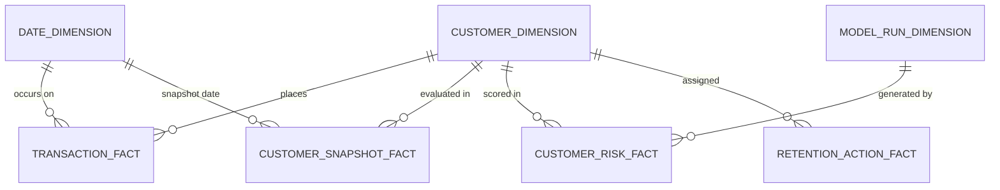

# RetentionLab Power BI Star Schema Data Model

## Relational Architecture

The data model uses a star-schema architecture centered on customer activity, transactions, and predictive risk scoring, linked by clean 1-to-Many single-direction relationships.

## Table Specifications & Grains

### 1. `CUSTOMER_DIMENSION` (Dimension)
- **Grain**: One row per customer (`customer_id`).
- **Primary Key**: `customer_id`
- **Attributes**: `signup_date`, `customer_segment`, `acquisition_channel`, `region`, `subscription_type`, `account_status`, `marketing_consent`.

### 2. `DATE_DIMENSION` (Dimension)
- **Grain**: One row per calendar day (`date_key`).
- **Primary Key**: `date_key`
- **Attributes**: `year`, `quarter`, `month_num`, `month_name`, `year_month`, `day_of_month`, `day_of_week`, `is_weekend`.

### 3. `TRANSACTION_FACT` (Fact)
- **Grain**: One row per transaction (`transaction_id`).
- **Primary Key**: `transaction_id`
- **Foreign Keys**: `customer_id` -> `CUSTOMER_DIMENSION[customer_id]`, `transaction_date` -> `DATE_DIMENSION[date_key]`.
- **Metrics**: `transaction_amount`, `discount_amount`, `refund_amount`.
- **Dimensions**: `transaction_type`, `payment_status`, `transaction_channel`, `transaction_status`.

### 4. `CUSTOMER_SNAPSHOT_FACT` (Fact)
- **Grain**: One row per customer per scoring observation (`snapshot_id`).
- **Foreign Keys**: `customer_id` -> `CUSTOMER_DIMENSION[customer_id]`, `snapshot_date` -> `DATE_DIMENSION[date_key]`.
- **Metrics**: `is_eligible` (1 = tenure >= 30 days, 0 = excluded).

### 5. `CUSTOMER_RISK_FACT` (Fact)
- **Grain**: One row per scored eligible customer (`score_id`).
- **Primary Key**: `score_id`
- **Foreign Keys**: `customer_id` -> `CUSTOMER_DIMENSION[customer_id]`, `snapshot_date` -> `DATE_DIMENSION[date_key]`.
- **Metrics**: `churn_probability`, `prioritization_score`, `historical_value_proxy`, `risk_weighted_exposure`, `is_top_15_percent`.
- **Attributes**: `risk_band`, `top_risk_signals`, `suggested_action`, `recommended_next_step`, `model_version`.

### 6. `RETENTION_ACTION_FACT` (Fact)
- **Grain**: One row per actionable retention assignment.
- **Foreign Keys**: `customer_id` -> `CUSTOMER_DIMENSION[customer_id]`.
- **Attributes**: `risk_band`, `churn_probability`, `prioritization_score`, `risk_weighted_exposure`, `suggested_action`, `is_top_15_percent`.

### 7. `MODEL_RUN_DIMENSION` (Dimension)
- **Grain**: One row per evaluated machine learning candidate or registered pipeline.
- **Attributes**: `model_name`, `val_roc_auc`, `test_roc_auc`, `test_pr_auc`, `test_f1`, `test_recall`, `test_precision`, `optimized_threshold`.

## Cardinality & Filter Direction Settings

| From (Fact Table) | Foreign Key | To (Dimension Table) | Primary Key | Cardinality | Cross Filter Direction |
| :--- | :--- | :--- | :--- | :--- | :--- |
| `TRANSACTION_FACT` | `customer_id` | `CUSTOMER_DIMENSION` | `customer_id` | Many to One (*:1) | Single (`CUSTOMER_DIMENSION` filters `TRANSACTION_FACT`) |
| `TRANSACTION_FACT` | `transaction_date` | `DATE_DIMENSION` | `date_key` | Many to One (*:1) | Single (`DATE_DIMENSION` filters `TRANSACTION_FACT`) |
| `CUSTOMER_RISK_FACT` | `customer_id` | `CUSTOMER_DIMENSION` | `customer_id` | Many to One (*:1) | Single (`CUSTOMER_DIMENSION` filters `CUSTOMER_RISK_FACT`) |
| `CUSTOMER_RISK_FACT` | `snapshot_date` | `DATE_DIMENSION` | `date_key` | Many to One (*:1) | Single (`DATE_DIMENSION` filters `CUSTOMER_RISK_FACT`) |
| `RETENTION_ACTION_FACT` | `customer_id` | `CUSTOMER_DIMENSION` | `customer_id` | Many to One (*:1) | Single (`CUSTOMER_DIMENSION` filters `RETENTION_ACTION_FACT`) |
