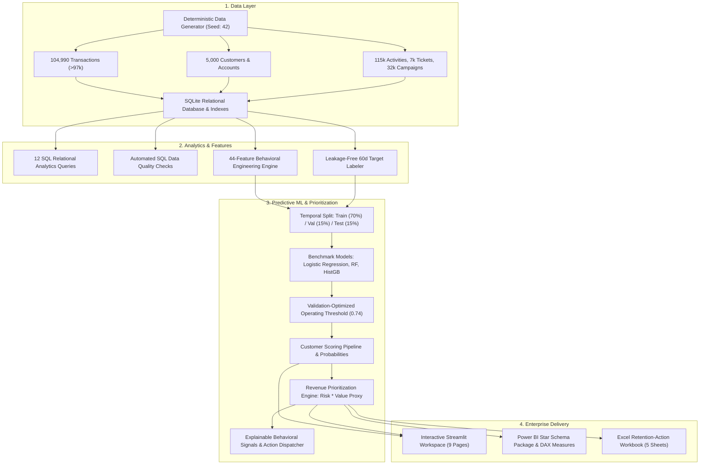

# RetentionLab Technical Architecture & Data Flow

## System Architecture Diagram

## Architectural Principles

1. **Separation of Concerns**: Data generation, feature engineering, predictive inference, and user presentation operate in independent modules with zero cyclic dependencies.
2. **Strict Leakage Isolation**: The scoring observation point ($T = \text{2026-04-01}$) strictly bounds historical feature calculations ($t \le T$). Target labels examine strictly future behavior ($T < t \le T + 60\text{d}$).
3. **Decoupled BI & Reporting**: Star-schema export tables conform to Kimball dimensional standards (`CUSTOMER_DIMENSION`, `DATE_DIMENSION`, `TRANSACTION_FACT`, `CUSTOMER_RISK_FACT`).
4. **Reproducible Pipeline**: A single command `python scripts/run_pipeline.py` executes all stages deterministically in ~15-20 seconds.
