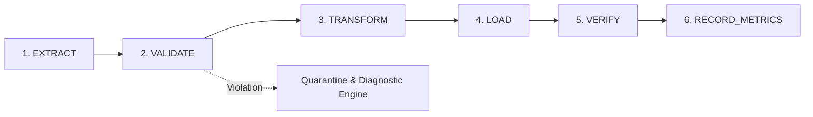

# SignalForge Platform Architecture

## 1. Architectural Principles & Ponytail Governance
SignalForge is designed as a production-grade data engineering control plane that avoids speculative abstractions while maintaining complete operational reliability. In accordance with the **Ponytail** engineering philosophy:
- **Smallest Complete Solution**: Focused Python components replace heavyweight, convoluted frameworks.
- **Single Source of Truth**: Explicit database state transitions (`PENDING -> RUNNING -> COMPLETED | FAILED`) recorded in PostgreSQL metadata tables.
- **Idempotent by Design**: Safe UPSERT semantics (`ON CONFLICT DO UPDATE`) and atomic transaction checkpoints guarantee zero duplicate records on repeated or interrupted runs.

## 2. Pipeline Lifecycle
Every pipeline run executes an explicit 6-stage lifecycle:

1. **Extract**: Reads source batch via configurable extractors (CSV, JSON, REST API, PostgreSQL, or simulated stream) with cursor-based incremental checkpoints.
2. **Validate**: 
   - Detects schema drift against active schema baseline version (`COMPATIBLE`, `POTENTIALLY_BREAKING`, `BREAKING`).
   - Executes 10 declarative data quality checks (not null, uniqueness, type check, non-negative range, timestamp format, referential integrity, category whitelist, count deviation, data freshness SLA, schema compatibility).
   - Segregates record-level rejections to `rejected_records` while enforcing batch-level policies (`FAIL_ON_ERROR` vs `REJECT_AND_CONTINUE`).
3. **Transform**: Normalizes schema, maps aliases, strips whitespace, converts data types, and applies domain cleaning.
4. **Load**: Transactionally executes upsert into destination dimensional or fact tables (`dim_customers`, `fact_transactions`), updating pipeline checkpoints in the exact same transaction block.
5. **Verify**: Post-load count reconciliation ensuring loaded row counts match expected transformed counts.
6. **Record Metrics**: Records execution duration, Prometheus counters/histograms, updates run status, and outputs structured JSON logs.

## 3. Reliability & Failure Recovery Laboratory
The platform includes 8 reproducible failure injection scenarios:
| Scenario ID | Fault Class | Expected Stage | Category | Recovery Strategy |
|---|---|---|---|---|
| `duplicate_records` | Data Integrity | `VALIDATE` | `DATA_QUALITY_VIOLATION` | Deduplicate in TRANSFORM or quarantine to `rejected_records`. |
| `missing_required_fields` | Completeness | `VALIDATE` | `DATA_QUALITY_VIOLATION` | Batch-fail policy halts execution; quarantine rows. |
| `breaking_schema_drift` | Schema Evolution | `VALIDATE` | `SCHEMA_DRIFT` | Drift detector halts batch before table corruption; alerts engineers. |
| `malformed_input` | Syntax Corruption | `EXTRACT` | `SOURCE_FORMAT_ERROR` | Extractor catches corrupt JSON/CSV; moves file to dead-letter queue. |
| `unavailable_api` | Infrastructure Outage | `EXTRACT` | `UPSTREAM_UNAVAILABLE` | Bounded retries with exponential backoff; triggers circuit breaker. |
| `referential_integrity` | Relational Constraint | `VALIDATE` | `DATA_QUALITY_VIOLATION` | Enforces DAG dependency ordering (customer dimension before facts). |
| `stale_data` | Freshness SLA | `VALIDATE` | `DATA_QUALITY_VIOLATION` | Flags delayed feeds; triggers upstream scheduler audit. |
| `interrupted_run_idempotent_retry` | Safe Re-run | `VERIFY` | `NONE` (Pass) | UPSERT semantics guarantee 0 duplicate rows created on re-execution. |
